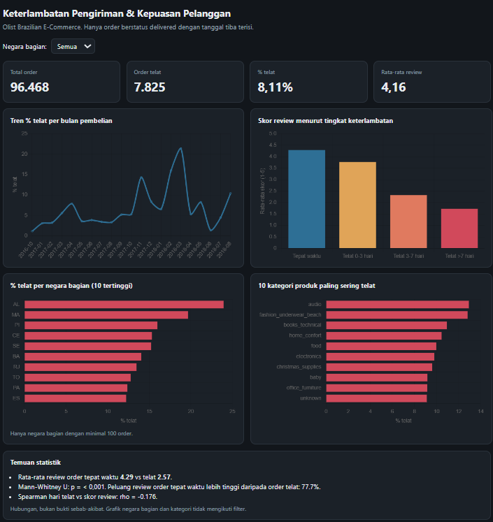

# Analisis Keterlambatan Pengiriman Olist

Projek ini melihat hubungan antara keterlambatan pengiriman dan skor review pelanggan di data e-commerce Olist (Brasil). Hasil utamanya: order yang tiba lewat estimasi dapat review rata-rata 2,57, sedangkan yang tepat waktu 4,29.



Dashboard interaktif: [isi link GitHub Pages di sini]

## Yang ingin dijawab

1. Berapa persen order yang telat, dan apakah berubah dari bulan ke bulan?
2. Negara bagian mana yang paling sering telat?
3. Seberapa jauh telat menurunkan skor review?
4. Kategori produk dan seller mana yang sering telat?
5. Apakah ongkir ada hubungannya dengan telat?

## Data

Brazilian E-Commerce Public Dataset by Olist dari Kaggle: 9 tabel, sekitar 99 ribu order. Data mentahnya tidak saya taruh di repo karena ukurannya besar. Unduh sendiri dari Kaggle, lalu taruh 9 file CSV-nya di `data/raw/`.

Yang saya pakai hanya order berstatus `delivered` yang tanggal tibanya terisi, jumlahnya 96.470. Order dengan status lain (canceled, shipped, unavailable, dan seterusnya) dibuang karena barangnya belum atau tidak sampai ke pelanggan. Ada juga 8 order `delivered` tanpa tanggal tiba, itu ikut dibuang.

Dari audit data ketemu dua hal. Pertama, 547 order punya lebih dari satu review. Saya ambil yang terbaru supaya JOIN tidak menggandakan baris. Kedua, 768 order tidak punya review sama sekali. Order itu tetap masuk analisis keterlambatan, tapi tidak masuk analisis skor.

"Telat" berarti tanggal tiba lebih lambat dari tanggal estimasi yang diberikan Olist.

## Metode

SQL (SQLite) dipakai untuk pembersihan dan query: view, JOIN beberapa tabel, CTE, dan window function. Python (pandas, scipy, matplotlib) dipakai untuk uji statistik, grafik, dan dashboard.

Skor review itu skala 1-5 (ordinal), jadi saya pakai Mann-Whitney U untuk membandingkan order telat dan tepat waktu, dan korelasi Spearman untuk melihat hubungan jumlah hari telat dengan skor. T-test kurang cocok untuk data seperti ini.

Negara bagian, kategori, dan seller dengan order terlalu sedikit (di bawah 100, 100, dan 50) tidak dihitung, karena persentase dari sampel kecil gampang ekstrem.

## Hasil

Dari 96.470 order, 7.826 (8,11%) telat.

Review rata-rata order tepat waktu 4,29, order telat 2,57. Review bintang 1 ada di 6,6% order tepat waktu dan 46,2% order telat. Mann-Whitney U memberi p < 0,001. Kalau diambil satu order tepat waktu dan satu order telat secara acak, peluang yang tepat waktu dapat review lebih tinggi sekitar 77,7%.

Di antara order yang telat saja, makin banyak hari telatnya makin rendah skor reviewnya (Spearman -0,52).

Per negara bagian, yang tertinggi AL 23,93%, MA 19,67%, dan PI 15,97%. AL hampir tiga kali rata-rata nasional.

Antar kategori produk perbedaannya lebih kecil. Tertinggi audio (12,93%), fashion_underwear_beach (12,82%), dan books_technical (10,94%), atau sekitar 1,3 sampai 1,6 kali rata-rata nasional. Jauh di bawah selisih AL.

Soal ongkir, median order telat 18,05 dan order tepat waktu 17,07. Secara statistik beda (p < 0,001), tapi selisihnya cuma sekitar 1 real, jadi saya tidak menganggapnya penyebab.

## Saran

- Perhatian utama ke AL, MA, dan PI. Kalau penyebabnya jarak, estimasi pengiriman ke sana sebaiknya dinaikkan supaya janji ke pelanggan lebih realistis.
- Kirim notifikasi begitu order lewat estimasi, karena makin lama telat makin jelek reviewnya.
- Pantau seller yang sering telat (daftarnya di `results/seller_terburuk.csv`).

## Catatan

Ini hubungan, bukan bukti sebab-akibat. Review rendah bisa juga karena produknya.

Dugaan bahwa jarak seller ke pelanggan jadi penyebab di AL, MA, dan PI belum saya uji.

Order tanpa review tidak masuk analisis skor. Orang yang menulis review biasanya yang sangat puas atau sangat kecewa, jadi skornya bisa agak condong.

## Menjalankan ulang

```
pip install pandas matplotlib scipy
python load_data.py      # muat 9 CSV di data/raw ke olist.db
python run_analysis.py   # hasil ke images/, results/, dashboard/
```

## Isi repo

```
sql/             query analisis
images/          grafik
results/         tabel hasil dan ringkasan
dashboard/       dashboard interaktif
load_data.py     memuat CSV ke SQLite
run_analysis.py  analisis, grafik, dashboard
```
